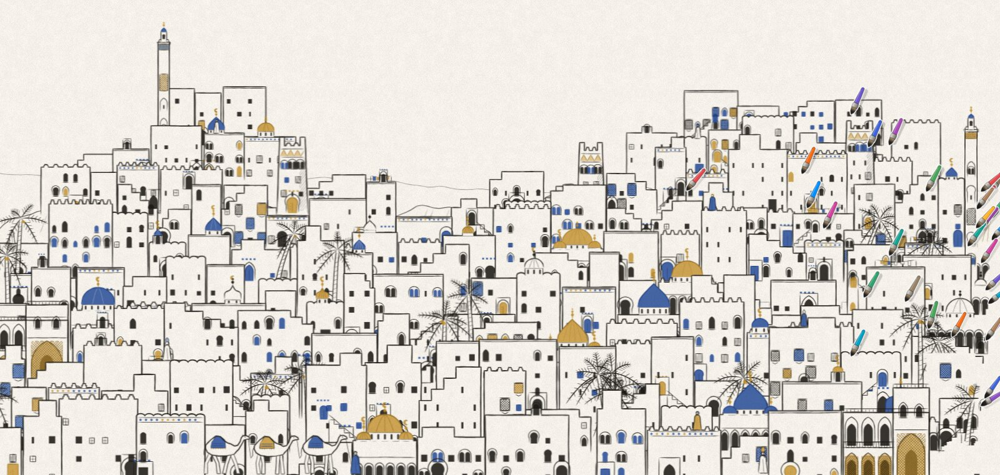

# Medina Drawing

**A screensaver for your devices:** an endless hillside medina (whitewashed houses, domes, minarets, kasbah
towers, palms, city gates and camel caravans) drawn live, stroke by stroke, by a crew of 30 brush cursors.
Black ink on paper with gold and blue accents, or chalk on indigo at night. The city never repeats: it keeps
scrolling and growing for as long as the screen is on.

It is one HTML file with no dependencies, no server code and no network requests, so it runs anywhere a modern
browser does: a spare monitor, a TV, a wall tablet, a kiosk, or as your desktop or TV screensaver.

## Use it as a screensaver

1. Get `index.html` (download it from this repo, or clone and run `./build.sh` to rebuild it).
2. Open it in a browser. Add `?tv` to the URL to hide the toolbar and name tags, which is what you want on a
   screensaver.
3. Point your device's screensaver, kiosk or "web page" display at it. Some ways to do that:
   - **Any browser:** open `index.html?tv` and press `F` for fullscreen.
   - **Desktop screensaver:** any screensaver that can show a web page (for example a "web page" or "URL"
     screensaver module) can load the file or a hosted copy.
   - **TVs, streaming sticks and tablets:** host the file on any static web server on your network (or a free
     static host) and open `http://<your-server>/index.html?tv` in a kiosk browser or a web-view screensaver app.

### URL options

| Option | Effect |
| --- | --- |
| `?tv` | Screensaver mode: no toolbar, no name tags, render width capped for TVs |
| `?seed=anything` | Draw a specific city (the same seed always gives the same city) |
| `?night` | Night version: chalk lines on indigo, lit windows, crescent moon and stars |
| `?night=auto` | Night between 19:00 and 07:00 local time, day otherwise |
| `?maxw=1280` | Cap the render width in device pixels (helps slow TVs and sticks) |
| `?composite=0` | Old per-layer renderer (slower; for debugging) |

### Keys

`Space` pause · `1` `2` `3` speed · `L` brush names · `M` night · `N` new city · `H` toolbar · `F` fullscreen

## How it works

- `build/medina-lib.js` generates the city as SVG, one object at a time: sky, two mountain ridges, a hazy far
  skyline, desert dunes where the city thins out, eleven rows of buildings up a hill whose height follows noise,
  and in front a crenellated city wall with a horseshoe gate, or palms in the open desert. Pen lines are thin
  ribbons, white fills are bodies that hide what lies behind them, and other fills are colour or ink washes.
- `build/parse.js` turns each SVG object into ordered drawing primitives, and `build/vis.js` drops whatever is
  hidden behind nearer buildings, so the brushes only paint lines you will actually see.
- `build/app.js` is the brush engine: it schedules the strokes across the 30 cursors, grows the ink behind each
  brush tip, layers the result by depth and moves the camera along the city. The SVG itself is never shown.
- `./build.sh` assembles `build/` into the single self-contained `index.html`.

### Development

- `node tools/preview.js SEED WIDTH out.svg` dumps the generator's raw SVG (no swarm) for fast iteration
  (`rsvg-convert out.svg -o out.png` to view it).
- `node tools/cdp-shot.js URL out.png SECONDS [W H]` runs the real page in headless Chromium and screenshots it.

## Built on open source

Medina Drawing uses and is inspired by other open-source projects. See [CREDITS.md](CREDITS.md) for details.

- **[shan-shui-inf](https://github.com/LingDong-/shan-shui-inf)** by Lingdong Huang (MIT): the seeded PRNG and
  Perlin noise, the SVG output format the engine reads, and the method of procedural pen strokes with white
  bodies that hide what lies behind them.
- **[swarm-cursors](https://github.com/DhvanilPatel/swarm-cursors)** by Dhvanil Patel and **Swarm** by Joel Califa:
  the idea of a swarm of cursors drawing together. No code from them is used.

## Authors

- **[laith-droid](https://github.com/laith-droid)**: author.
- **Claude** (Anthropic's AI assistant, via Claude Code): contributor. Claude co-wrote the generator and the
  brush engine; its commits carry a `Co-Authored-By` trailer.

## License

[MIT](LICENSE) © 2026 laith-droid. The bundled shan-shui-inf code keeps its own MIT licence
([build/SHANSHUI-LICENSE](build/SHANSHUI-LICENSE)).
